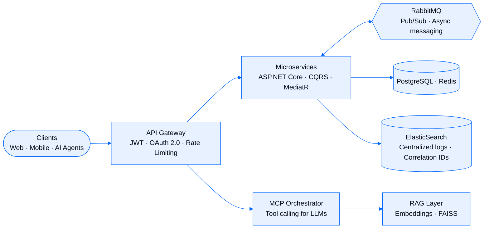

<picture>
  <source media="(prefers-color-scheme: dark)" srcset="https://readme-typing-svg.demolab.com?font=Fira+Code&weight=500&size=18&duration=3000&pause=1000&color=4D94FF&center=true&vCenter=true&repeat=true&width=620&height=24&lines=Software+Engineer+%40+Odeabank;.NET+8+%C2%B7+Microservices+%C2%B7+CQRS+%C2%B7+RabbitMQ;RAG+%C2%B7+Multi-Agent+%28LangGraph%29+%C2%B7+MCP+%C2%B7+QLoRA;Building+production-ready+AI+for+finance;Istanbul%2C+Turkey">
  
</picture>

> Software Engineer with corporate backend experience in the **financial sector**. I build distributed
> microservice systems with **.NET 8, ASP.NET Core, RabbitMQ and CQRS/MediatR**, and ship
> production-ready AI solutions with **RAG, multi-agent orchestration (LangGraph), LLM fine-tuning (QLoRA) and MCP**.

<table>
  <tr>
    <td align="center" width="25%"><h3>70+</h3>MCP tools engineered</td>
    <td align="center" width="25%"><h3>8</h3>enterprise platforms built at Odeabank</td>
    <td align="center" width="25%"><h3>165+</h3>automated tests in Pipeline Sentinel AI</td>
    <td align="center" width="25%"><h3>96.85%</h3>decision accuracy, YKS Placement Predictor</td>
  </tr>
</table>

<table>
  <tr valign="top">
    <td width="33%">
      <b>Day job</b> 
      Software Engineer at <b>Odeabank</b> — MCP tool infrastructure, event-driven microservices and RAG chatbots for banking.
    </td>
    <td width="33%">
      <b>Leading</b> 
      AI Team Lead at the <b>Istanbul Softito (ITO)</b> AI Engineering Academy, affiliated with the Istanbul Chamber of Commerce.
    </td>
    <td width="33%">
      <b>Shipping</b> 
      AlphaMemo, Pipeline Sentinel AI and FinVoice Ops — AI products with live demos, several with public source.
    </td>
  </tr>
</table>

## Expertise

<table>
  <tr>
    <th width="33%">Backend & Distributed Systems</th>
    <th width="33%">Applied AI & LLM</th>
    <th width="33%">Data & Platform</th>
  </tr>
  <tr valign="top">
    <td>

- ASP.NET Core (.NET 8), C#, EF Core
- CQRS, MediatR, Clean Architecture
- Event-driven design: RabbitMQ, Saga, Outbox
- API Gateway, JWT & OAuth 2.0, rate limiting
- Redis distributed caching
- Swagger/OpenAPI, versioning, HATEOAS

</td>
    <td>

- RAG pipelines with FAISS & hybrid search
- Multi-agent orchestration with LangGraph
- LLM fine-tuning (QLoRA), prompt engineering
- Model Context Protocol (MCP) servers & tools
- Human-in-the-loop workflows
- Speech: Whisper, STT / TTS services

</td>
    <td>

- PostgreSQL, MSSQL, MongoDB, ElasticSearch
- ETL/ELT, data quality, lineage, anomaly detection
- Centralized logging & observability
- Docker, Kubernetes, OpenShift
- Git, GitHub Actions, CI/CD
- Linux, systemd deployments

</td>
  </tr>
</table>

<picture>
  <source media="(prefers-color-scheme: dark)" srcset="https://skillicons.dev/icons?i=cs,dotnet,java,spring,python,fastapi,flask,nodejs,js,ts,cpp&theme=dark">
  
</picture>
 
<picture>
  <source media="(prefers-color-scheme: dark)" srcset="https://skillicons.dev/icons?i=react,tailwind,vite,rabbitmq,redis,elasticsearch,postgres,mongodb,docker,kubernetes,linux&theme=dark">
  
</picture>
 
<picture>
  <source media="(prefers-color-scheme: dark)" srcset="https://skillicons.dev/icons?i=pytorch,tensorflow,git,github,githubactions,vercel,vscode,idea,androidstudio&theme=dark">
  
</picture>

  

### How I design systems

The patterns I work with day to day: gateway-secured, event-driven and observable.

## Experience

### Odeabank — Software Engineer Intern
`Istanbul` · `Jul 2025 — Present`

| Platform | What I built |
|---|---|
| **MCP Tools Infrastructure** | 70+ MCP tools behind an API Gateway, on CQRS, MediatR, an MCP Orchestrator, a ViewModel layer and Redis distributed cache — designed for 20+ public and 50+ OAuth 2.0-authenticated banking services. |
| **Trendyol Finance Chatbot (RAG & MCP)** | FAISS vector search with embedding models; NLP middleware for dynamic endpoint selection, hybrid search and Pydantic schema validation over MCP. |
| **Speech Service Platform** | STT/TTS for the AI Voice Assistant on a .NET Web API (Sestek, Google Speech, OpenAI Whisper) with Factory and Strategy patterns; Faster-Whisper in production on Linux via systemd. |
| **Workforce Management Platform** | Full-stack HR team-management app on ASP.NET Core (.NET 8) and React.js with Clean Architecture and EF Core; timesheet tracking and job definitions built end to end. |
| **Fraud Detection & Identity Verification** | NFC, PIN and SMS verification flows on RabbitMQ pub/sub, keeping inter-service dependencies low through asynchronous messaging. |
| **Centralized Logging** | Distributed, structured logging over RabbitMQ and ElasticSearch; correlation IDs give cross-service traceability and faster error detection. |
| **API Gateway Modernization** | JWT Bearer and OAuth 2.0 with rate limiting, request routing and load balancing. |
| **Performance Management System** | Role-based evaluation app on React 19, TypeScript, Tailwind CSS and TanStack Query — backend integration, production deployment and an xUnit/Moq test foundation. |

**Stack:** .NET 8 · ASP.NET Core · C# · EF Core · React 19 · TypeScript · Tailwind CSS · RabbitMQ · PostgreSQL · Redis · ElasticSearch · MediatR · JWT · OAuth 2.0 · RAG · MCP · FAISS · Whisper · Swagger/OpenAPI · Docker · Kubernetes · xUnit · Moq

### Earlier roles

| Company | Role | Period | Highlights |
|---|---|---|---|
| **LC Waikiki** | Software Engineer Intern | Jul 2024 — Sep 2024 | RESTful services on ASP.NET Core Web API, EF Core and Clean Architecture; API standards with AutoMapper, FluentValidation, Swagger/OpenAPI and versioning; Redis caching, rate limiting and HATEOAS. |
| **Smart System Electronic** | Software Engineer Intern | Jun 2023 — Sep 2023 | Corporate Android app in Java — XML layouts, REST API integration and local storage, delivered end to end. |

## Featured Projects

<table>
  <tr valign="top">
    <td width="50%">

**[AlphaMemo](https://alphamemo.vercel.app)** 
AI investment evaluation

Cuts VC pre-evaluation to seconds: FAISS RAG pipeline, Qwen2.5-1.5B fine-tuned with QLoRA and a 4-agent LangGraph state machine behind FastAPI.

`Python` `FastAPI` `LangGraph` `FAISS` `QLoRA`

[Live demo](https://alphamemo.vercel.app)

</td>
    <td width="50%">

**[Pipeline Sentinel AI](https://www.pipelinesentinel.dev)** 
Data reliability platform

Detects pipeline failures early — data contracts, anomaly detection, lineage and impact mapping — with confidence-scored root-cause reports. 100% RCA accuracy across 6 failure scenarios, 165+ automated tests.

`Python` `FastAPI` `PostgreSQL` `SQLAlchemy` `Playwright`

[Live demo](https://www.pipelinesentinel.dev) · [Source](https://github.com/ZEYDLCN/PipeSentinel)

</td>
  </tr>
  <tr valign="top">
    <td>

**FlowGuard** 
Distributed transaction & incident management

Event-driven microservices for real-time financial transactions: Saga/Outbox, idempotent consumers, retry/DLQ, Circuit Breaker, trace IDs and health checks.

`.NET 8` `CQRS` `MediatR` `RabbitMQ` `Redis` `Kubernetes`

</td>
    <td>

**[FinVoice Ops](https://github.com/ZEYDLCN/FinVoice)** 
Local-first voice AI automation

Voice AI for banking and insurance operations with no paid API: LangGraph agent with tool calling, REST integration, RAG search, STT/TTS and Prometheus/Grafana/OpenTelemetry observability.

`Python` `LangGraph` `Ollama` `faster-whisper` `Next.js`

[Source](https://github.com/ZEYDLCN/FinVoice)

</td>
  </tr>
  <tr valign="top">
    <td>

**[YKS Placement Predictor](https://tercih-asistani-projects.vercel.app)** 
University placement prediction

Predicts placement for 11,154 programs from 7 years of data using a lognormal model and Monte Carlo — **96.85%** decision accuracy, **98.79%** band coverage.

`Python` `React` `TypeScript` `SciPy` `Polars`

[Live demo](https://tercih-asistani-projects.vercel.app)

</td>
    <td>

**[YDS Smart Study](https://yds-2vuo.onrender.com)** 
Adaptive learning PWA

1,100+ practice questions, personalized study plans and 660 vocabulary flashcards, driven by spaced repetition and learning analytics.

`PWA` `Spaced Repetition` `Learning Analytics`

[Live demo](https://yds-2vuo.onrender.com)

</td>
  </tr>
  <tr valign="top">
    <td>

**[Folume](https://folume.2103013235.workers.dev)** 
Academic PDF reading platform

Mobile-first reader that turns PDFs into an optimized reading experience: PDF processing, document rendering and responsive UI/UX.

`PDF Processing` `Responsive Design` `UI/UX`

[Live demo](https://folume.2103013235.workers.dev) · [Source](https://github.com/ZEYDLCN/folume)

</td>
    <td align="center" valign="middle">

**More on GitHub**

Data pipelines, ML models and tooling.

[Browse all repositories →](https://github.com/ZEYDLCN?tab=repositories)

</td>
  </tr>
</table>

<b>More projects</b> — data engineering, machine learning, tooling

 

| Project | Highlights |
|---|---|
| **Retail Sales ETL Pipeline** | Python, Pandas, PostgreSQL — CSV/API ingestion into a star schema |
| **Transaction Data Pipeline** | Python, RabbitMQ, PostgreSQL — event → validate → persist |
| **Customer Churn Prediction** | XGBoost on telecom data — 92% accuracy, 89% F1 |
| **Housing Price Prediction** | Regression model — R² = 0.88 |
| **AutoCAD Floor Plan Generator** | Hybrid DL + ML model — 97.3% accuracy |
| **Fortify AI Fixer** | VS Code extension that parses SAST reports and suggests LLM-powered fixes |
| **MCP & N8N Chatbot** | NLP chatbot combining MCP with N8N automation |
| **PlantMedic** | AI plant-disease detection from images |
| **Blog Post Application** | Spring Boot + MongoDB, with JUnit/Mockito tests |
| **Task Management System** | N-Tier backend with optimized SQL Server queries |

## Education & Certifications

| Institution | Program | Period |
|---|---|---|
| **Istanbul Softito (ITO)** | AI Engineering Academy — AI Team Lead, affiliated with the Istanbul Chamber of Commerce | Sep 2026 — Nov 2026 |
| **Atatürk University** | Web Design & Development | 2025 — 2027 |
| **Beykent University** | Software Engineering | 2021 — 2025 |

## GitHub Activity

<picture>
  <source media="(prefers-color-scheme: dark)" srcset="assets/top-langs-dark.svg">
  
</picture>

  

<picture>
  <source media="(prefers-color-scheme: dark)" srcset="https://streak-stats.demolab.com/?user=ZEYDLCN&hide_border=true&background=0d1117&ring=0066FD&fire=0066FD&currStreakLabel=4D94FF&sideNums=c9d1d9&currStreakNum=c9d1d9&sideLabels=4D94FF&dates=6e7681">
  
</picture>

## Let's Connect

I enjoy talking about distributed systems, applied AI and MCP integrations in regulated environments.
The best way to reach me is [LinkedIn](https://www.linkedin.com/in/zeyd-alcan-33a1a5225) or
[email](mailto:zeydalcan00@gmail.com); I also write on [Medium](https://medium.com/@ZeydAlcan).

 

  

