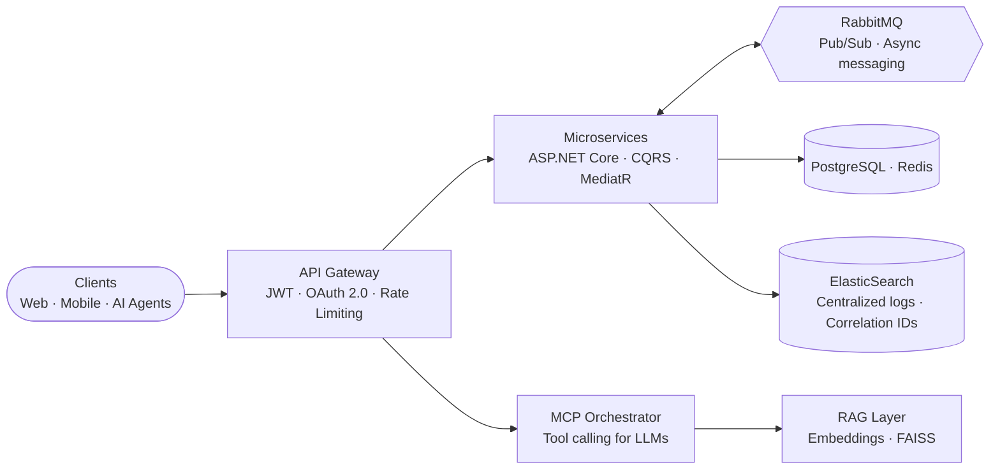
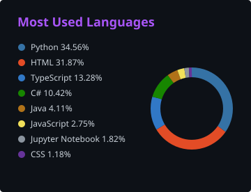

---

## 👋 Profile

> Software Engineer with corporate backend experience in the **financial sector**. I build distributed
> microservice systems with **.NET 8, ASP.NET Core, RabbitMQ and CQRS/MediatR**, and ship
> production-ready AI solutions with **RAG, multi-agent orchestration (LangGraph), LLM fine-tuning (QLoRA) and MCP**.

<table>
  <tr>
    <td align="center" width="25%"><h3>70+</h3>MCP tools engineered</td>
    <td align="center" width="25%"><h3>8</h3>enterprise platforms built at Odeabank</td>
    <td align="center" width="25%"><h3>165+</h3>automated tests in Pipeline Sentinel AI</td>
    <td align="center" width="25%"><h3>96.85%</h3>decision accuracy, YKS Placement Predictor</td>
  </tr>
</table>

| | |
|---|---|
| **Role** | Software Engineer — Backend & Applied AI |
| **Company** | Odeabank, Istanbul |
| **Focus** | Distributed systems · AI integration (RAG, Agentic RAG, MCP) · API security |
| **Languages** | Turkish (native) · English (B2) |
| **Certified by** | Anthropic — Claude Code, Claude API, MCP |

---

## 🧭 Expertise

<table>
  <tr>
    <th width="33%">⚙️ Backend & Distributed Systems</th>
    <th width="33%">🤖 Applied AI & LLM</th>
    <th width="33%">🗄️ Data & Platform</th>
  </tr>
  <tr valign="top">
    <td>

- ASP.NET Core (.NET 8), C#, EF Core
- CQRS, MediatR, Clean Architecture
- Event-driven design: RabbitMQ, Saga, Outbox
- API Gateway, JWT & OAuth 2.0, rate limiting
- Redis distributed caching
- Swagger/OpenAPI, versioning, HATEOAS

</td>
    <td>

- RAG pipelines with FAISS & hybrid search
- Multi-agent orchestration with LangGraph
- LLM fine-tuning (QLoRA), prompt engineering
- Model Context Protocol (MCP) servers & tools
- Human-in-the-loop workflows
- Speech: Whisper, STT / TTS services

</td>
    <td>

- PostgreSQL, MSSQL, MongoDB, ElasticSearch
- ETL/ELT, data quality, lineage, anomaly detection
- Centralized logging & observability
- Docker, Kubernetes, OpenShift
- Git, GitHub Actions, CI/CD
- Linux, systemd deployments

</td>
  </tr>
</table>

### 🛠️ Tech Stack

 

 

  

### 🏗️ How I Design Systems

A reference view of the patterns I work with day to day — gateway-secured, event-driven, observable.

---

## 💼 Experience

### Odeabank — Software Engineer Intern
`Istanbul` · `Jul 2025 — Present`

| Platform | What I built |
|---|---|
| **MCP Tools Infrastructure** | 70+ MCP tools behind an API Gateway. Scalable architecture with CQRS, MediatR, an MCP Orchestrator, a ViewModel layer and Redis distributed cache, designed for 20+ public and 50+ OAuth 2.0-authenticated banking services. |
| **Trendyol Finance Chatbot (RAG & MCP)** | RAG server on a FAISS vector database with embedding models for semantic search; NLP middleware with dynamic endpoint selection, hybrid search and Pydantic schema validation over MCP. |
| **Speech Service Platform** | STT/TTS services for the AI Voice Assistant, built as a .NET Web API integrating Sestek, Google Speech and OpenAI Whisper, with Factory and Strategy patterns for provider selection. Python Faster-Whisper deployed to production on Linux via systemd. |
| **Workforce Management Platform** | Full-stack HR team-management platform on ASP.NET Core (.NET 8) and React.js — Clean Architecture, EF Core, DI — with timesheet effort tracking and job-definition infrastructure, end to end. |
| **Fraud Detection & Identity Verification** | NFC, PIN and SMS verification flows on a RabbitMQ event-driven pub/sub architecture, keeping inter-service dependencies minimal through asynchronous messaging. |
| **Centralized Logging Infrastructure** | Distributed logging on RabbitMQ and ElasticSearch with structured logs and async transmission; correlation IDs give cross-service traceability and shorter error detection time. |
| **API Gateway Modernization** | JWT Bearer and OAuth 2.0 authentication integrated with rate limiting, request routing and load balancing to optimize inter-service communication. |
| **Performance Management System** | Role-based performance evaluation app on React 19, TypeScript, Tailwind CSS and TanStack Query — frontend, backend integration, production deployment and an xUnit/Moq unit-test foundation. |

**Stack:** .NET 8 · ASP.NET Core · C# · EF Core · React 19 · TypeScript · Tailwind CSS · RabbitMQ · PostgreSQL · Redis · ElasticSearch · MediatR · JWT · OAuth 2.0 · RAG · MCP · FAISS · Whisper · Swagger/OpenAPI · Docker · Kubernetes · xUnit · Moq

### Earlier Experience

| Company | Role | Period | Highlights |
|---|---|---|---|
| **LC Waikiki** | Software Engineer Intern | Jul 2024 — Sep 2024 | RESTful backend services with ASP.NET Core Web API and EF Core on Clean Architecture; enterprise API standards (Repository-Service pattern, AutoMapper, FluentValidation, Swagger/OpenAPI, versioning); Redis caching, rate limiting, data shaping and HATEOAS for faster API responses. |
| **Smart System Electronic** | Software Engineer Intern | Jun 2023 — Sep 2023 | Corporate Android app in Java — XML UI layouts, REST API integration and SharedPreferences local storage, delivered end to end. |

---

## 🚀 Featured Projects

| Project | What it does | Stack | Links |
|---|---|---|---|
| **FlowGuard** Transaction & incident management | Event-driven microservices platform for real-time financial transactions — Saga/Outbox patterns, idempotent consumers, retry/DLQ; Circuit Breaker, correlation/trace IDs, health checks and rate limiting. | `.NET 8` `EF Core` `MSSQL` `CQRS` `MediatR` `RabbitMQ` `Redis` `JWT` `Docker` `Kubernetes` | — |
| **AlphaMemo** AI investment evaluation | Cuts VC pre-evaluation to seconds. RAG pipeline on FAISS, Qwen2.5-1.5B fine-tuned with QLoRA on synthetic data, and a 4-agent LangGraph state machine behind a FastAPI service on HuggingFace Spaces + ZeroGPU. | `Python` `FastAPI` `LangGraph` `FAISS` `QLoRA` `Pydantic` | [Live](https://alphamemo.vercel.app) |
| **Pipeline Sentinel AI** Data reliability platform | Early detection of pipeline failures: data contracts, robust z-score anomaly detection, quality monitoring, column-level lineage and downstream impact mapping. Confidence-scored root-cause reports with human-approved SQL/dbt patch suggestions — 100% RCA accuracy across 6 failure scenarios, 165+ automated tests. | `Python` `FastAPI` `PostgreSQL` `SQLAlchemy` `Playwright` | [Live](https://www.pipelinesentinel.dev) · [Code](https://github.com/ZEYDLCN/PipeSentinel) |
| **FinVoice Ops** Local-first voice AI | Voice AI for banking and insurance operations with no paid API. LangGraph agent with tool calling, enterprise REST integration, RAG search, STT/TTS and Prometheus / Grafana / OpenTelemetry observability. | `Python` `LangGraph` `Ollama (Qwen3)` `faster-whisper` `Piper TTS` `Next.js` `Docker` | — |
| **YKS University Placement Predictor** | Placement prediction for 11,154 programs from 7 years of data using lognormal distribution and Monte Carlo — **96.85%** decision accuracy, **98.79%** band coverage. | `Python` `React` `TypeScript` `Tailwind` `SciPy` `Polars` | [Live](https://tercih-asistani-projects.vercel.app) |
| **YDS Smart Study** Adaptive learning PWA | Progressive web app with 1,100+ practice questions, personalized study plans and 660 vocabulary flashcards, powered by spaced repetition and learning analytics. | `PWA` `Spaced Repetition` `Learning Analytics` | [Live](https://yds-2vuo.onrender.com) |
| **Folume** Academic PDF reader | Mobile-first reading platform that turns PDF documents into an optimized reading experience — PDF processing, document rendering and responsive UI/UX. | `PDF Processing` `Responsive Design` `UI/UX` | [Live](https://folume.2103013235.workers.dev) |

<b>More projects</b> — data engineering, machine learning, tooling

 

| Project | Highlights |
|---|---|
| **Retail Sales ETL Pipeline** | Python, Pandas, PostgreSQL — CSV/API ingestion into a star schema |
| **Transaction Data Pipeline** | Python, RabbitMQ, PostgreSQL — event → validate → persist |
| **Customer Churn Prediction** | XGBoost on telecom data — 92% accuracy, 89% F1 |
| **Housing Price Prediction** | Regression model — R² = 0.88 |
| **AutoCAD Floor Plan Generator** | Hybrid DL + ML model — 97.3% accuracy |
| **Fortify AI Fixer** | VS Code extension that parses SAST reports and suggests LLM-powered fixes |
| **MCP & N8N Chatbot** | NLP chatbot combining MCP with N8N automation |
| **PlantMedic** | AI plant-disease detection from images |
| **Blog Post Application** | Spring Boot + MongoDB, with JUnit/Mockito tests |
| **Task Management System** | N-Tier backend with optimized SQL Server queries |

---

## 🎓 Education & Certifications

| Institution | Program | Period |
|---|---|---|
| **Istanbul Softito (ITO)** | AI Engineering Academy — AI Team Lead, affiliated with the Istanbul Chamber of Commerce | Sep 2026 — Nov 2026 |
| **Atatürk University** | Web Design & Development | 2025 — 2027 |
| **Beykent University** | Software Engineering | 2021 — 2025 |

---

## 📊 GitHub Activity

  

---

## 🤝 Let's Connect

I enjoy talking about distributed systems, applied AI and MCP integrations in regulated environments.
The best way to reach me is [LinkedIn](https://www.linkedin.com/in/zeyd-alcan-33a1a5225) or
[email](mailto:zeydalcan00@gmail.com); I also write on [Medium](https://medium.com/@ZeydAlcan).

 

  

